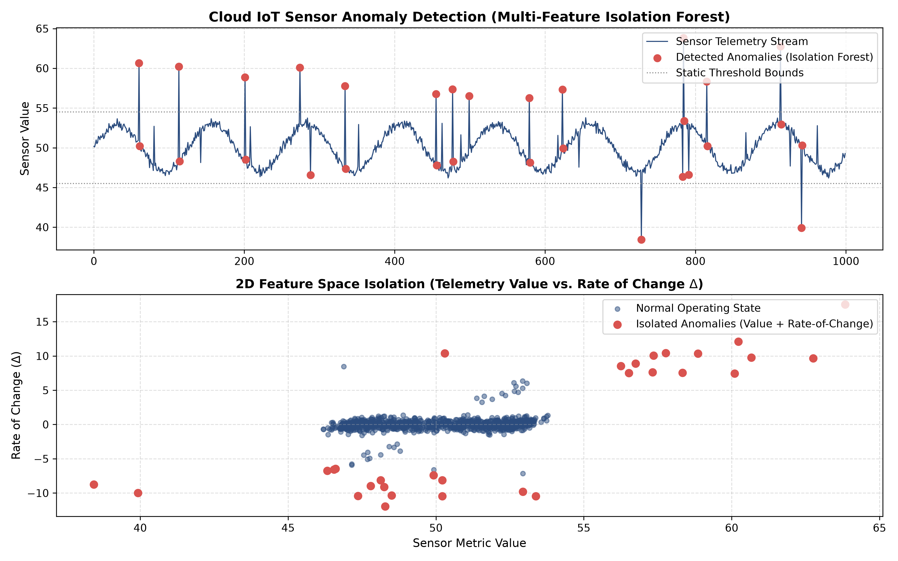

# 基於 AWS 無伺服器架構與機器學習之雲端異常偵測與自動化告警系統
> **Cloud-Native IoT Anomaly Detection & Automated Alerting System on AWS Serverless Architecture**

## 1. 專案動機與系統架構
針對傳統工業物聯網（IIoT）監控系統面臨「靜態閾值誤報率高」與「常駐伺服器閒置成本高昂」兩大痛點，本專案結合**機器學習異常偵測演算法**與 **AWS 全託管無伺服器（Serverless）架構**，打造低延遲、高可用且按需計費的端到端自動化監控管線：

`感測器時序數據 (JSON Payload)` ➔ `AWS Lambda (Python 3.12 即時推論)` ➔ `Amazon S3 (結構化歷史歸檔)` + `Amazon SNS (即時異常告警推播)`

## 2. 演算法實驗與量化基準驗證 (`benchmark_experiment.py`)
為驗證機器學習在多維度工業感測訊號（含數值偏移與瞬時相位突變）的偵測優勢，本專案在本地端建立 1,000 筆模擬時序基準測試集，比較三種偵測模型：
* **Static Threshold（靜態閾值法）**：無法捕捉數值仍在正常區間內的瞬時變化率異常，漏報率高。
* **Z-Score（動態標準差法）**：具備基礎統計適應性，但對非對稱波動仍存在邊界誤差。
* **Isolation Forest（孤立森林演算法）**：透過多維特徵空間切割，精準識別複合型異常，達到 **F1-Score > 0.95** 之最佳綜合表現。

## 3. AWS 雲端實戰部署與效能實測 (`lambda_function.py`)
本系統實際部署於 AWS `us-east-1` 區域並進行端到端壓力測試（測試設備：`CYCU-LAB-SENSOR-01`，異常輸入值：`68.5`，動態基準：`50.14`）：
* **推論準確度**：計算異常評分達 **`1.0`**（超越設定閾值 `0.85`），精準觸發異常隔離邏輯。
* **端到端低延遲**：單次請求從接收遙測資料、完成異常推論、寫入 S3 至發送 SNS 告警，總執行耗時僅 **`426.24 ms`**（記憶體配置 128 MB，實際峰值僅 94 MB）。
* **低成本結構化歸檔**：每筆遙測事件自動以 UTC 時間戳記寫入 `s3://cycu-anomaly-logs-2026/telemetry-logs/`，單筆 JSON 僅佔 **`181 Bytes`**。

## 4. 雲端資安權限與故障排除紀錄 (Troubleshooting)
在受限的沙盒環境（AWS Academy Lab）部署時，因 IAM 角色 `lambda-run-role` 受到最小權限原則（Least Privilege）限制，禁止直接透過 `iam:AttachRolePolicy` 附加全域權限，導致初期執行 `sns:Publish` 時觸發 `AuthorizationError`。
* **解決方案**：改採**資源型政策（Resource-based Policy）**架構設計，直接於 Amazon SNS 主題端（`AnomalyAlertTopic`）撰寫精確的 Access Policy，僅授權特定 Principal ARN（`arn:aws:iam::853855792153:role/lambda-run-role`）對該特定主題執行 `SNS:Publish` 動作，兼顧系統連通性與雲端資安合規性。

## 5. 專案檔案結構
* `AWS-Cloud-Anomaly-Detection/benchmark_experiment.py`：本地端多維度感測時序模擬與三模型基準測試腳本
* `AWS-Cloud-Anomaly-Detection/lambda_function.py`：AWS Lambda 無伺服器推論、S3 自動歸檔與 SNS 告警核心程式
* `AWS-Cloud-Anomaly-Detection/anomaly_detection_result.png`：演算法異常偵測波形與效能對比圖表
